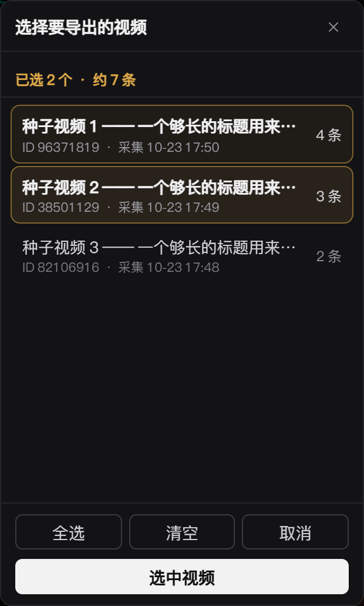
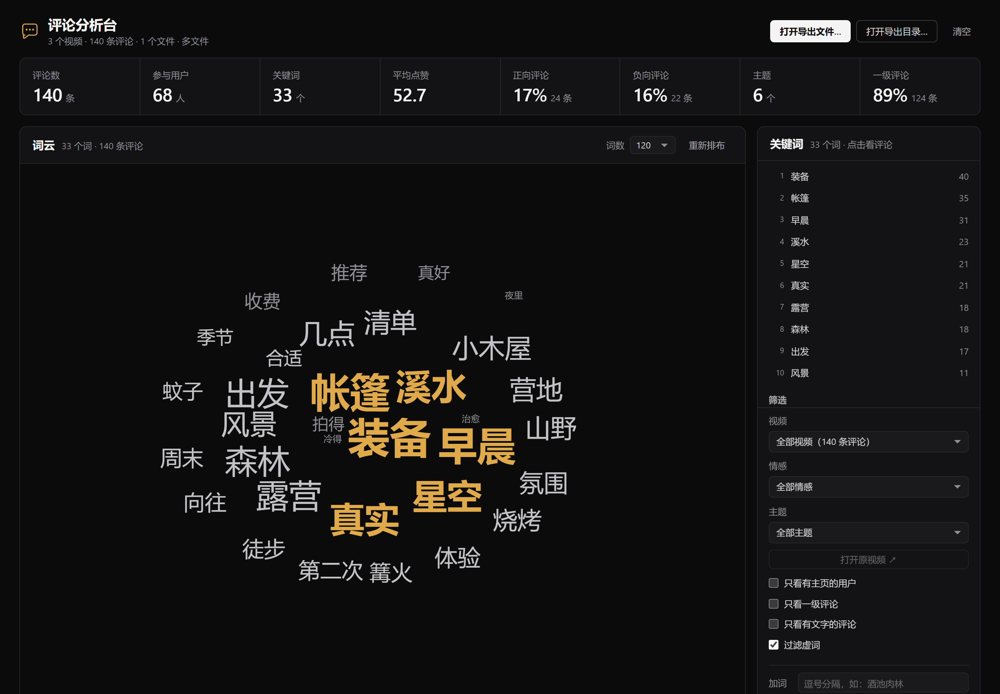
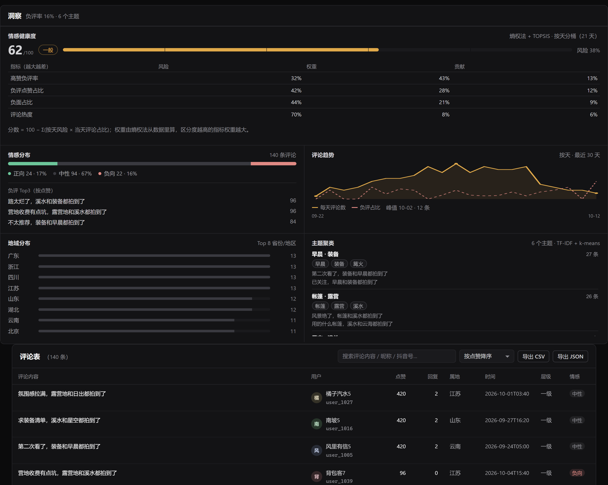
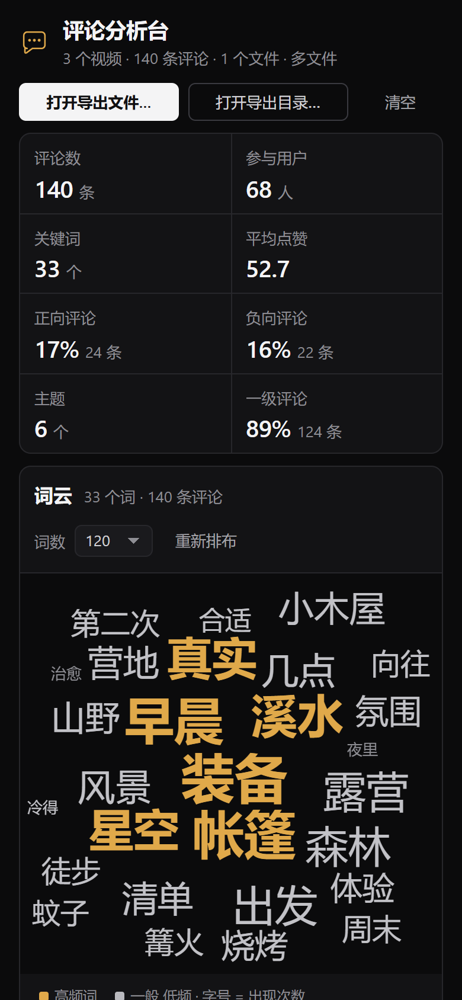

# 抖音评论采集器 · 评论分析台

把抖音的**公开评论**采下来，导出 CSV / JSON，再用内置的**评论分析台**做词云、情感、主题、趋势与健康度分析——全程在本地完成，不上传任何数据。

三种用法，按需要挑：

| 你想做的事 | 用这个 |
| --- | --- |
| 手动采某个视频/主页的评论 | Chrome 扩展（**douyin-collector**） |
| 让 AI 直接帮你采 | DSH 插件（**dsh-douyin-comments**）或本地 MCP（**douyin-mcp**） |
| 分析已导出的评论 | 评论分析台（**comment-viewer** / DSH 侧栏 **dsh-comment-viewer** / 扩展面板一键导出） |

[](https://github.com/monagisa/douyin-ai-collector/releases/latest)


> 当前版本 **v0.5.53**（扩展 / DSH 插件 / MCP **三件套同号**）。下载打包好的产物走 [Releases](https://github.com/monagisa/douyin-ai-collector/releases/latest)，仓库里只放源码。

---

## 界面

**浏览器扩展面板**——开始/暂停、目标条数、风控观测；导出范围、导出词云；选中要导出的视频：



**评论分析台**——KPI、可交互词云、关键词榜与筛选：



**洞察面板**——情感健康度（熵权法 + TOPSIS）、情感分布、评论趋势、地域 Top 8、主题聚类（TF-IDF + k-means）：



**手机 / 平板**——≤620px 评论表自动变卡片列表，触屏热区 ≥40px：



> 以上截图使用**合成数据**（虚构视频与评论），不含任何真实用户信息。

---

## 采集

- **不破解签名**：复用页面自己生成的 `a_bogus` 签名，只改分页游标与游标回放；不伪造请求、不绕过登录。
- **采集能力**：顶层评论分页（3 路错峰 200ms，服务端并页会自动降回单路）、二级回复补采、目标条数（到量只停顶层、回复仍补完）、限速与「回复预热」可调。
- **适用范围**：视频详情页 / 推荐流 / 主页网格 / 关注 / 朋友 / 我的 等页面按 DOM 形态自适应；部分页面需要手动展开评论区。
- **导出**：CSV（20 列，含第 2 行中文列名说明；多条视频 21 列）/ JSON；范围可选「任意几条视频」。
- **一键词云**：面板「导出词云」→ 新标签页直接打开分析台；也可在云图页「下载 HTML」得到**自包含单文件**（数据+样式+脚本全内联，双击即用，可转发）。

## 评论分析台

纯静态页面，双击 `comment-viewer/index.html` 即可，或通过扩展 / DSH 侧栏打开：

- **词云**：悬停放大 + 弹出「说了这个词的评论」；点击词语开抽屉、点评论跳用户主页。
- **KPI 8 格**：评论数、参与用户、关键词、平均点赞、正向、负向、主题数、一级评论占比。
- **洞察**：情感健康度（0~100 + 五级评价 + 四项风险指标权重/贡献）、情感分布、按天评论趋势与负评占比、地域 Top 8、主题聚类（簇标签 + 代表评论 + 条数）。
- **筛选**：视频 / 情感 / 主题 / 只看有主页 / 只看一级 / 只看有文字 / 过滤虚词；支持**自定义加词**与**屏蔽词**。
- **导出**：CSV 14 列（含情感、主题）、JSON（含 `sentiment`/`score`/`topic`）、导出筛选结果。
- 多文件载入、管理记录（可批量删除磁盘上的导出）。

## AI 工具链

- **dsh-douyin-comments**（DSH / Cordis 插件）：把采集注册成 agent 原生工具 `douyin_comments`，插件自带浏览器扩展副本，第一次调用自动装进它启动的浏览器；只交付本次新采的数据。
- **douyin-mcp**（本地 MCP，stdio）：12 个工具——采集控制（状态/开采/暂停/直播状态/读评论/导出/清空/词云）、设置、以及基于 SQLite(FTS5) 的统计/检索（`summary`/`stats`/`query`/`search`/`sample`/`sentiment`）。
- **dsh-comment-viewer**（DSH 客户端插件）：在 DSH 侧栏加「评论词云」页，自动读取 `~/.dsh/douyin-collector/out` 里最新的导出。

---

## 目录结构

```text
douyin-ai-collector/
├─ README.md                 ← 本文件
├─ douyin-collector/         ← Chrome MV3 扩展（采集主体 + 面板 + 内联词云页）
├─ comment-viewer/           ← 评论分析台（纯静态单页：词云 / 洞察 / 表格）
├─ dsh-douyin-comments/      ← DSH 插件：agent 工具 douyin_comments（自带扩展副本）
├─ dsh-comment-viewer/       ← DSH 客户端插件：侧栏「评论词云」
└─ douyin-mcp/               ← 本地 MCP server（采集控制 + 评论检索/统计）
```

## 快速开始

**1. 只采集（扩展）**

1. Chrome / Edge → `chrome://extensions`（`edge://extensions`）→ 开发者模式 → **加载已解压的扩展程序** → 选 `douyin-collector/`
2. 在**这个浏览器**里登录抖音，打开视频页 → 面板 **开始采集** → **导出 CSV**
3. 面板「导出范围」可选任意几条已采视频；「导出词云」一键打开分析台

**2. 做分析（分析台）**

- 直接双击 `comment-viewer/index.html`，把导出的 JSON / CSV 拖进去；或从扩展面板「导出词云」打开。
- 首次本地打开时按钮可能需要点一下（浏览器对 `file://` 的文件选择框有限制），从 DSH 侧栏或 `python -m http.server` 打开没有任何限制。

**3. 让 AI 采（DSH 插件）**

```bash
dsh plugin --profile web add file:<本仓库绝对路径>/dsh-douyin-comments
```

然后直接对 agent 说「采集这个视频的评论 <链接>」。目标条数、并发路数、回复限速/预热、等扫码秒数、是否先清空等都能在**面板齿轮 / DSH 插件设置 / MCP 工具参数**三处调整（优先级：面板 > AI 下发 > 默认）。

**4. 只要 MCP**

```bash
cd douyin-mcp && node mcp.js
```

在 MCP 客户端注册为 stdio server 即可（详见 [douyin-mcp/README.md](./douyin-mcp/README.md)）。

## 版本与发布

- **v0.5.15 起三件套统一编号**；当前 `0.5.53`。
- 打包产物（扩展 zip / 插件 tgz / 整包 / MCP zip / 使用说明 / SHA256SUMS）见 [Releases](https://github.com/monagisa/douyin-ai-collector/releases/latest)。
- 最近几版：
  - **0.5.53** 自选导出浮层去掉复选框（整行点击切换）
  - **0.5.50** 评论分析台 v4.0 设备兼容（断点 / 卡片化表格 / 触屏 / 减少动效）
  - **0.5.46** 情感健康度（熵权法 + TOPSIS）+ 「导出词云」改为新标签页
  - **0.5.45** 分析台加入洞察面板（情感 / 趋势 / 地域 / 主题）
  - **0.5.41** 关键词算法升级（视频内 IDF + 自定义词表）

## 合规提示

- 仅用于自有账号、公开数据与研究场景；可能违反平台用户协议，**风险自负**。
- 不要提交 Cookie、浏览器 profile、私钥或真实评论数据集到任何仓库。
- 采集是只读的：不发帖、不点赞、不关注。

## 文档

| 主题 | 文档 |
| --- | --- |
| 扩展使用与限制 | [douyin-collector/README.md](./douyin-collector/README.md) |
| 安装 / 打包 | [douyin-collector/INSTALL.md](./douyin-collector/INSTALL.md) |
| 内部协议（签名、分页、面板、导出格式） | [douyin-collector/PROTOCOL.md](./douyin-collector/PROTOCOL.md) |
| 评论分析台 | [comment-viewer/README.md](./comment-viewer/README.md) |
| DSH 采集插件 | [dsh-douyin-comments/README.md](./dsh-douyin-comments/README.md) |
| DSH 侧栏词云页 | [dsh-comment-viewer/README.md](./dsh-comment-viewer/README.md) |
| 本地 MCP | [douyin-mcp/README.md](./douyin-mcp/README.md) |
